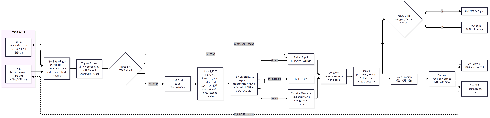
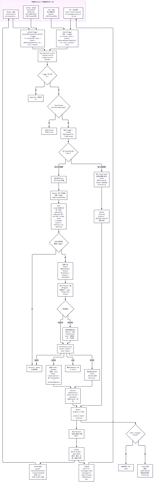

# DSH Super Agent：飞书 / GitHub 消息处理流程

> 对照对象：`_ref`（dsh-superagent-prototype，commit `6337fc8`）。
> 依据：`_ref/docs/002-authorization.md`、`_ref/docs/007-architecture.md`、`_ref/src/sources/{feishu*,github*,host,poll}.ts`、`_ref/src/core/{intake,evals}.ts`、`_ref/src/app/{passes,outbox,delivery}.ts`、`_ref/src/executor/dsh.ts`。
> 注意：这是**原型**的流程；ZeoKeel 在本轮加入了“IM 入站先进入待审批”的产品策略，与原型不同，见文末对比。

## 1. 一张图看全流程

完整版（含 Intake/订阅 fan-out、Gate、Eval、Decision、Executor、Outbox 的全部节点）：

Mermaid 源文件：`design/diagrams/dsh-im-pipeline.mmd`、`design/diagrams/dsh-im-flow.mmd`。

## 2. 飞书怎么接

原型不直接使用飞书官方 SDK，而是通过 **`lark-cli` 的机器人身份（strict mode bot）** 接入：

| 能力 | 实现 |
| --- | --- |
| 实时收消息 | 常驻子进程 `lark-cli event consume im.message.receive_v1 --as bot`，stdout 逐行 NDJSON；stderr 的 `[event] ready` 作为就绪信号；断线按 1s→60s 退避重连 |
| 补历史 | `lark-cli api GET /open-apis/im/v1/messages` 按 chat/topic、`start_time`/`end_time`、升序分页补收；每 60s 一轮 |
| 补话题回复 | 订阅中的 Thread 按 `readPageSize` 轮询 topic 页；14 天 polling horizon；已见 message_id 去重 |
| 群列表/名字 | `lark-cli im +chat-list --page-all` 每分钟刷新，仅作显示 |
| 回复 | `lark-cli im +messages-reply --message-id <m> --markdown <text> --reply-in-thread --idempotency-key <receipt-id>` |
| 配置/策略 | chats（仅 @ / 全部消息）、其他群、私聊；允许的 `ou_` 用户、bot 名单；admission 表行 = 每个群/其他群/私聊 |

消息归一化（`feishu-trigger.ts`）：

- 跳过 bot 自己（`sender_id == botId/appId`）。
- `Trigger.id = key('feishu', message_id)`：实时事件、历史补收、线程轮询三条路径拿到的同一条消息得到**同一个 ID**，所以天然去重。
- Thread：`chatId:rootId ?? messageId`。
- `addressed`：私聊 = `direct`；群里命中 bot mention = `mention`；否则无。
- 带上 `chatId/messageId/direct/mentioned/rootId/parentId/threadId`，回复时原路回该消息所在话题。

## 3. GitHub 怎么接

通过 **智能体账号的 `gh` CLI（通常是带独立 `GH_CONFIG_DIR` 的 wrapper）** 轮询 GitHub API：

| 能力 | 实现 |
| --- | --- |
| 通知 | `GET notifications?all=true&per_page=50&since=<cursor>`；按仓库过滤；读 Issue/PR 及评论；cursor 在整轮成功后原子推进 |
| 仓库级事件流 | `issues?state=all`（同时覆盖 Issue/PR）、`issues/comments`、`pulls/comments`；由 `observeIssues/observePulls/observeComments` 开关；各自 cursor/ETag |
| 打开工单的 PR/CI | 对 open Ticket 的 PR 读 checks，只在失败集合变化时产生 CI Trigger；默认分支 CI 也有独立 baseline |
| 订阅线程轮询 | 对订阅的 Issue/PR Thread 拉新评论、review、inline comment；14 天 horizon |
| 关闭/合并 | PR merge/close 或 Issue close → `threadClosed` → 工单在“follow 的 Thread 都结束”时按 merged/closed 结束 |
| 回复 | `gh api issues/<n>/comments` 或 `pulls/<n>/comments/<root>/replies`；正文带 `<!-- dsh-superagent:<receipt-id> -->` 防重复 |

GitHub Trigger 归一化（`github-trigger.ts`）：

- Issue/PR：`id = key('github-issue', number)`；评论：`key('github-comment', html_url, comment.id, updated_at)`——编辑后是新版本。
- `human`：不是 `[bot]`、不是 GitHub App、不是智能体自己的账号。
- `addressed`：正文/评论里 @ 了智能体账号。
- CI Trigger：`actor` 为空、`human=false`、无 channel；只能走 admission 表最后一格。
- 频道：Issue/PR 会话；review comment 回复到 root comment 的 thread。

## 4. 收到消息后的处理流程

### 4.1 进入 Engine：Intake

`SourceContext.receive(trigger)` → `Passes.receive` → `Engine.receive`（`src/core/intake.ts`）：

1. **规范化时间**（ISO）并检查至少一个 Thread。
2. **幂等**：同一 `Trigger.id` 已存在 → `duplicate`，丢弃。
3. **SourceScope 过滤**：Source 当前位置是否还监听该 scope；不监听 → `filtered` + 原因，不进入 Eval。
4. **存 Trigger/Thread**，记录 Thread 关联、`lastAt`、disposition。
5. **fan-out 到订阅该 Thread 的 Tickets**：
   - 只有“人的消息”能让已结束的 Ticket 恢复；bot/CI 不会。
   - 消息变成 Ticket 的 `Input`；Worker 下次被唤醒时处理，自己决定这是不是本 Ticket 的 follow-up。
   - 如果该消息被 Worker 认为超出 Ticket 范围，可以 handback，之后重新进入 Eval。
6. **没有 Ticket 拥有**的消息 → 进入该 Thread 的 Eval 队列；`Passes` 每 2 秒 `evaluateDue()`（收到新 Trigger 也会立即 request）。

### 4.2 Gate：谁有资格发起工作

每个 Thread 的 Eval 先看 Gate（`policy.gate`，`docs/002`）：

- `explicit`：名单内的人 @ 机器人或私聊机器人；或 admission 表的“unlisted-addressed”格设为 explicit。
- `inferred`：名单外的人跟帖、admission 表推断格、名单内 bot 的消息。
- `not admitted`：其他 bot、admission 表 ignore、`accept mode=off` 时的所有 inferred。

同一 Thread 的 queued Triggers 会**批量**成一个 Eval，取最强的一条作为 primary；如果一条都不可受理，记录 ignore Decision（带原因），不创建 Ticket。

### 4.3 Main Session 决策

Eval 的 candidate card 送到 **Main Session（编排 Agent）**。它用工具做决策：

- **explicit**：`orchestrator_route` → `accept`（新工单）/ `attach`（交给已有 Ticket）/ `stop`（人要求停）/ `ignore`（普通讨论）。
- **inferred**：按启用的 rules 做评估：
  - `observe`：记录 “would accept” 的 Decision，不建工单；
  - `auto`：规则命中才 accept；
  - `off`：不受理。
- **超时**：Eval 过期会 requeue 两次，第三次记录 `unavailable`；Policy 变化会使运行中的 Eval 失效并重排。
- 已由 Ticket Worker 拥有的 follow-up：Main Session 只能 stop，不能 accept/attach。

> 原型没有“人类审批队列”。accept 是 Main Session 的决策；人只能通过 stop/Policy 干预。ZeoKeel 目前把 IM 入站改为 proposal + 人工 Approve，这是产品差异，不是 DSH 原型的流程。

### 4.4 Accept → Ticket → Executor

`accept` 在一个事务里创建：

- **Ticket**：origin Trigger、Mandate（强度/basis/rules）、Subscriptions、首个 Assignment；
- **acknowledgement**：通过 Outbox 排队回复来源会话；
- 启动效应（launch effect）→ **Executor**（`DshExecutor`）创建 worker session 和一个独立 workspace 目录，投递 Inputs，运行 Agent。

Worker 的 Report：

- `progress`：内部进度，通常不打扰人；
- `ready`：完成；如果 Ticket follow 了 PR/Issue，则等 Thread close；
- `blocked` / `failed`：等待人；可对应 retry；
- 具体问题：形成 attention reply，回到来源会话；
- `dropped`：结束 Ticket。

### 4.5 后续消息、PR/Issue 关闭、工单结束

- 订阅 Thread 上的新消息：继续 fan-out 给 Ticket 作为 Input；人写的消息可恢复已结束但未被人工 stop 的 Ticket。
- Worker 可把越界消息 handback；handback 后若无人拥有，则重新 Eval。
- GitHub PR merged/closed / Issue closed：`threadClosed`；Ticket 在所有 follow 的 Thread 都结束时按 merged/closed 结束。
- Ticket 结束时，未被 Worker 读/接手的 follow-up 释放回 Eval（除非其他 Ticket 拥有或已 settled）。

### 4.6 回复：Outbox

- Engine 把 acknowledgement/answer/result/attention 作为 `OutboundMessage` 写 Outbox；`receipt` + `reply` effect 在同一事务入队。
- effect 按 Ticket+会话顺序发送；Source 关闭/不监听时等待或丢弃。
- 飞书：`lark-cli im +messages-reply ... --idempotency-key`；GitHub：`gh api .../comments` + HTML marker。
- 永久失败（消息撤回、Issue 删除/锁定）标记 `channelGone`，不无限重试。

## 5. 关键不变量

1. **Trigger ID 确定性**：实时/补收/轮询三条路重复读到同一消息不会重复建工单。
2. **Intake 是唯一入口**：所有来源都必须先变成 Trigger；Eval 之前没有别的工作创建路径。
3. **Gate 与 Eval 分离**：模型只能判断语义，不能把不可受理的消息升级为 explicit。
4. **Ticket/Mandate/Subscription 三者绑定**：工单只在 Mandate 范围内工作；Thread 订阅决定后续消息流向。
5. **回复走 Outbox**：来源离线/不监听时消息不会“假发出去”。
6. **PR/Issue 生命周期驱动结束**：merged/closed 是结束条件，不是 worker 自己说 ready 就算完。

## 6. 与 ZeoKeel 的差异

| 维度 | DSH 原型 | ZeoKeel rc2 |
| --- | --- | --- |
| 飞书传输 | `lark-cli` bot 事件消费 + 历史/线程轮询 | 官方 `larkws` 长连接（SDK），longpoll 兜底 |
| 钉钉 | （原型无） | Stream SDK（bot）/ DWS 个人 OAuth 长连接 |
| IM 入站 | Gate → Eval → Main Session 直接 accept/ignore | **所有 IM 入站 → 待审批 proposal**，人工 Approve 才建 Ticket |
| 审批 | 无独立人类审批队列 | 收件箱 + Approve/Reject/Undo |
| 消息处理 | Intake fan-out + Eval + Main Session + Executor + Outbox | 同构（我们实现了 intake/eval/gate/ticket/executor/outbox） |
| 列表/详情 | Thread/Ticket 列表 + 会话 | 项目/会话/任务 + 收件箱/诊断 |

如果 ZeoKeel 要和原型完全对齐，需要把“IM 入站强制审批”改为 accept mode（observe/auto）+ Main Session 路由；当前产品选择的是更保守的审批优先。
