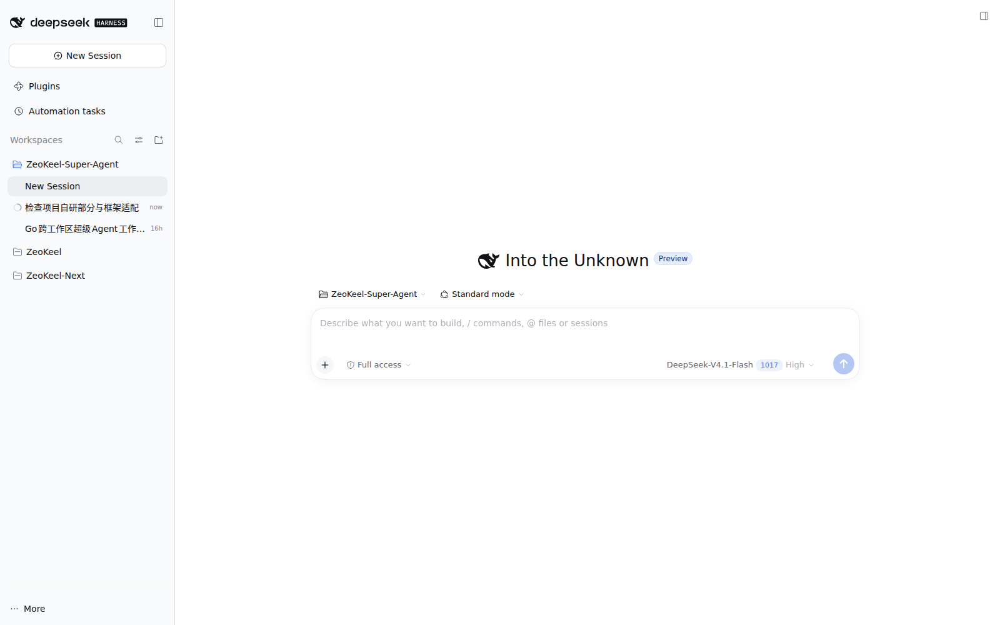
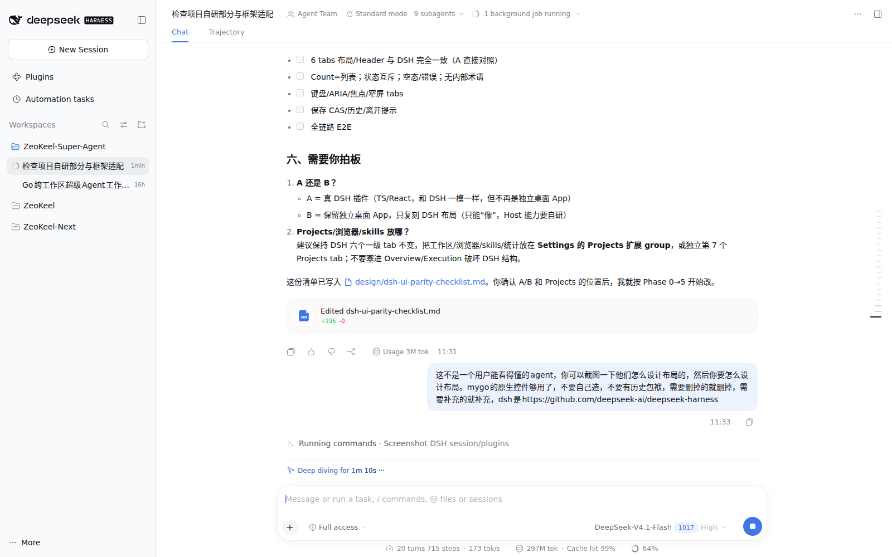
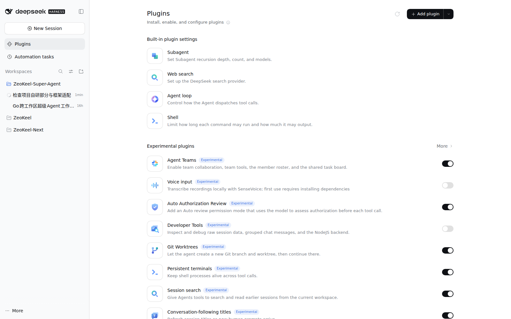
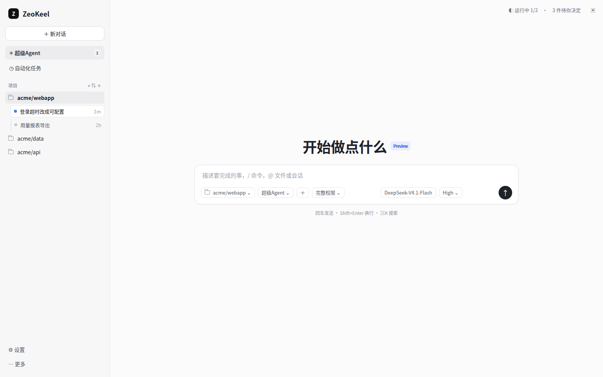
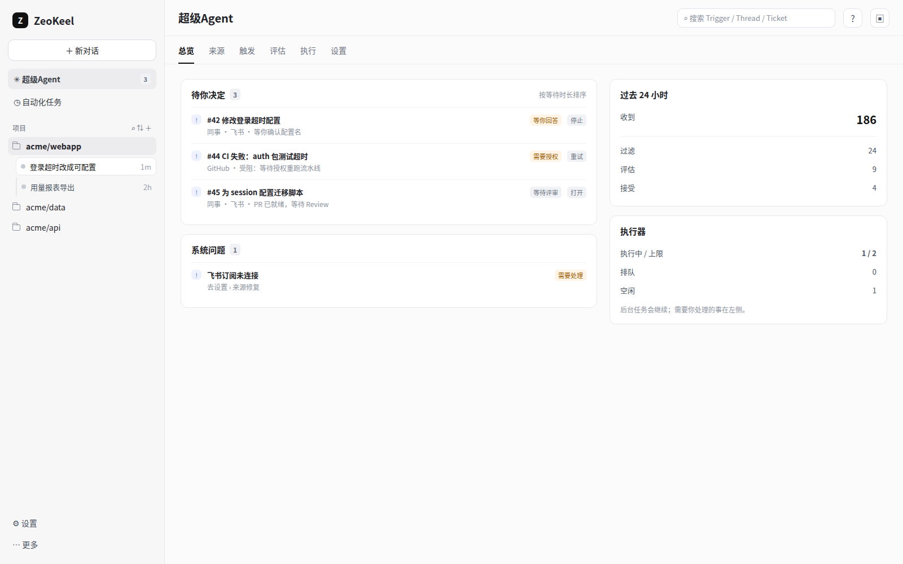

# 目标 UI：像 DSH 一样“宿主 + 插件面板”，用 mygo 原生控件实现

> 参考：DeepSeek Harness Web 实际界面（截图见 `design/dsh-reference/`）+ `_ref/src/client/**`（SuperAgent 面板源码）。
> 定位：**独立桌面 App（mygo）**，但交互/布局按 DSH：左侧宿主侧栏 + 主区会话/首页 + 一个“超级Agent”面板入口。超级Agent 不再是整个应用，而是一个面板（plugin-like），聊天/会话属于宿主。

## 1. DSH 实际界面截图

### 1.1 宿主首页


要点：
- 约 280–300px 左侧栏；顶部品牌 + **New Session** 主按钮。
- 导航：**Plugins / Automation tasks**，下面是 **Workspaces**（搜索/筛选/新建），工作区列表与当前工作区的会话列表。
- 主区首页：大标题 + **一个居中的 composer**（项目 chip、模式、权限、模型、发送），没有顶部 tabs。
- 底部只有 `… More`，没有监控/诊断/状态栏。

### 1.2 会话页


要点：
- 左侧栏不变；主区顶部是会话标题 + **Chat / Trajectory**，右侧运行状态/后台任务。
- 中间是消息流；底部 composer 固定。
- 工具调用、文件变更等作为消息内卡片；状态/成本等放底部一行。
- 没有“工作区树”“总览/执行页”混在聊天里。

### 1.3 插件页


要点：
- 插件是侧栏里的一个入口；点开是独立列表页（Built-in / Experimental，开关、Add plugin）。
- SuperAgent 正是这种插件：侧栏图标 → 主面板（六个 tab），不是宿主首页。

## 2. 目标布局（我们的 App）

### 2.1 首页 / 新会话（宿主）


- 左侧栏 280px：
  - 品牌 ZeoKeel
  - **＋ 新对话**（主按钮）
  - **超级Agent**（面板入口，带待决定数 badge）
  - **自动化任务**
  - **项目**：搜索/新建；项目列表；选中项目下显示**会话列表**（不再用可展开树）
  - 底部：设置 / 更多
  - 删除：监控组、工作区树、收件箱、诊断、状态栏
- 主区：
  - 大标题（如“开始做点什么”）
  - 居中 composer：项目 chip、模式（Agent/超级Agent）、权限、模型、发送
  - 没有顶部 tabs、没有监控仪表盘
- 交互：
  - 新对话 → 空 composer；发送后进入会话页。
  - 选项目只决定新会话/任务默认目录；不隐式过滤全局页。
  - 超级Agent 是单独入口，不占首页。

### 2.2 超级Agent 面板（plugin-like）


- 与 DSH 插件一致：侧栏点“超级Agent”打开一个面板，面板内部：
  - Header：标题、全局搜索、术语表、**打开主 Session**。
  - **顶部 6 Tabs**：总览 / 来源 / 触发 / 评估 / 执行 / 设置。
  - 内容区：Overview 只显示“待你决定 / 系统问题 / 过去 24 小时 / 执行器”；每个区块链接到对应 tab。
  - 详情页（Thread/Ticket）带返回；筛选 Pills；Load more；保存条/历史。
- 聊天不放在面板里；面板只做监督和配置。
- 我们的扩展（项目浏览器 / skills / 统计）放在 **设置 › 项目** 扩展组或独立第 7 个 Projects tab；不塞进 Overview/Execution。

## 3. 布局规格（直接用 mygo 原生控件）

### 3.1 结构
```
Window
├─ Sidebar (Width 280)
│  ├─ Brand Row
│  ├─ Button "＋ 新对话"
│  ├─ NavRow "超级Agent" (Badge N)
│  ├─ NavRow "自动化任务"
│  ├─ SectionHeader "项目" + IconButton 搜索/新建
│  ├─ ProjectRow (selected)
│  ├─ SessionRow ×N
│  └─ Spacer + Settings/More
└─ Main
   ├─ HomeView: Title + Composer
   ├─ SessionView: Header(Chat/Trajectory) + Scroll(Messages) + Composer
   └─ SuperAgentView: Header(Search/Glossary/OpenMaster) + Tabs 6 + Page
```
### 3.2 mygo 控件映射（不造新控件）

| 用途 | 原生控件 |
| --- | --- |
| 顶部 6 tabs | `mui.Tabs` / `mui.Segmented`（不要自绘 tab） |
| 筛选 pills | `mui.Segmented` 或 `mui.Button`（选中态用 Button 样式） |
| 主按钮/次按钮/图标按钮 | `mui.Button` / `mui.ButtonBase` |
| 搜索/输入框 | `mui.TextInput` |
| 多行 composer / 说明 | `mui.TextArea` |
| 开关 | `mui.Switch` |
| 下拉（项目/模型/模式） | `mui.Select` / `mui.MenuButton` |
| 计数 badge | `mui.Badge` |
| 弹窗/确认/术语表 | `mui.Modal` / `mui.DialogBase` |
| 滚动区/消息流 | `mui.Scroll` / `mui.ScrollBoth` |
| spinner/progress | `mui.Spinner` / `mui.Progress` |
| 文本/标题 | `mui.Text` / `mui.Textf` |
| 图标 | `mui.Icon` + 现有 SVG 资源（只作图标资产，不自造图标控件） |
| 行/列/布局 | `mui.Row` / `mui.Column` / `Spacer`（组合布局，不是新控件） |

**删掉的自造控件/层**：
- `internal/ui/widgets.go` 的 `card`/`cardG`/`chip`/`chipOn`：用 `mui.Column`+边框/背景/`mui.Badge`/`mui.Button` 替代。
- 自绘 sidebar nav/tree（`chrome.go`、`workspace.go` 树）：用 `mui.Column`+`Button`+`Scroll` 组合。
- 自定义 Segmented/Tabs 若已有：改用 `mui.Tabs`/`mui.Segmented`。
- 自绘状态点/标签：`mui.Badge`+`Text` 组合；状态色来自 tokens。
- 自绘 toast/loading：用原生 `Spinner`/`Progress` + 一个全局 Row（不新建 UI 控件库）。

保留：SVG 图标资产、tokens（颜色/字号 scale）、Markdown 解析（内容渲染，不是控件）。

## 4. 要删的内容（历史包袱）

1. **左侧“监控”分组**（消息/来源/触发/评估/执行）：来源/触发/评估/执行改为超级Agent 面板的 tab；消息=会话/记录，不再是一级页面。
2. **可展开工作区树**：改项目列表 + 会话列表（DSH 宿主做法）。
3. **收件箱独立入口**：待你决定进入 Overview；没有单独 inbox 页。
4. **诊断分组/诊断页**：技术细节收进面板的 Source/Trigger/Eval/Execution 或设置›高级；主界面不出现。
5. **底部状态栏**（版本/rev/Go/CGO/SQLite/帮助快捷键）：删除；版本进设置›关于。
6. **首页聊天+总览混合**：拆成“宿主首页/会话”与“超级Agent 面板”。
7. **自定义 card/chip/segmented/图标按钮**：按上表换原生控件。
8. **旧审批/提案相关文案/入口**：已删；不要复活。

## 5. 要补的内容

1. **New Session** 主按钮；会话页 Chat/Trajectory 头。
2. **超级Agent 面板入口 + Header**（搜索/术语表/打开主 Session）。
3. **6 Tabs 页面**：Overview / Source / Trigger / Eval / Execution / Settings（按 DSH 区块/详情页/筛选/Pills/Load more）。
4. **Thread/Ticket 详情路由 + 返回**。
5. **Settings 5 组 + SaveBar + 历史 + Prompts 编辑器**。
6. **项目/会话列表**（项目选择、会话行、最近活动）；项目创建/重命名/删除。
7. **我们的扩展**：浏览器（Chrome/Edge/Node/npx）、skills、统计、应用到项目，放在设置›项目或第 7 tab。
8. **统一状态/计数/时间/Markdown/术语表**；所有 Count=列表。
9. **键盘/ARIA/Tabs 方向键/Modal/ESC/Enter**（原生控件已带大部分，补齐 label）。

## 6. 分阶段落地

### Phase 1：宿主壳（先改观感）
- [ ] 左侧栏改为 DSH 宿主样式：品牌/新对话/超级Agent/自动化/项目+会话列表/设置/更多。
- [ ] 主区拆 HomeView / SessionView；DSH 式居中 composer。
- [ ] 删监控组/工作区树/收件箱/诊断/状态栏。
- [ ] 用 `mui.Tabs` 替换自绘导航；用原生 Button/TextInput/TextArea/Select。

### Phase 2：超级Agent 面板
- [ ] Header：搜索/术语表/打开主 Session。
- [ ] 6 Tabs 骨架 + 路由/返回。
- [ ] Overview / Source / Trigger / Eval / Execution / Settings 按 DSH 结构实现。
- [ ] Thread/Ticket 详情页；筛选/分页/保存条。

### Phase 3：扩展与收尾
- [ ] 项目›设置/统计（浏览器/skills/应用到项目）。
- [ ] 键盘/ARIA/空态/加载/toast。
- [ ] 删除所有旧 UI 文件/导出/测试；更新设计文档。

## 7. 需要确认

1. **是否就按“宿主 + SuperAgent 面板”的独立 App 方案（B）做？** 你明确说 mygo 原生控件够用，我理解为保留 Go 桌面 App，只复刻 DSH 布局，不做 TS 插件。
2. **项目浏览器/skills/统计**放 **设置›项目** 还是第 7 个 Projects tab？我建议设置›项目（保持 DSH 六 tab 不变）。

确认后我从 Phase 1 开始实际改 UI；本轮只出设计/截图，不动代码。
